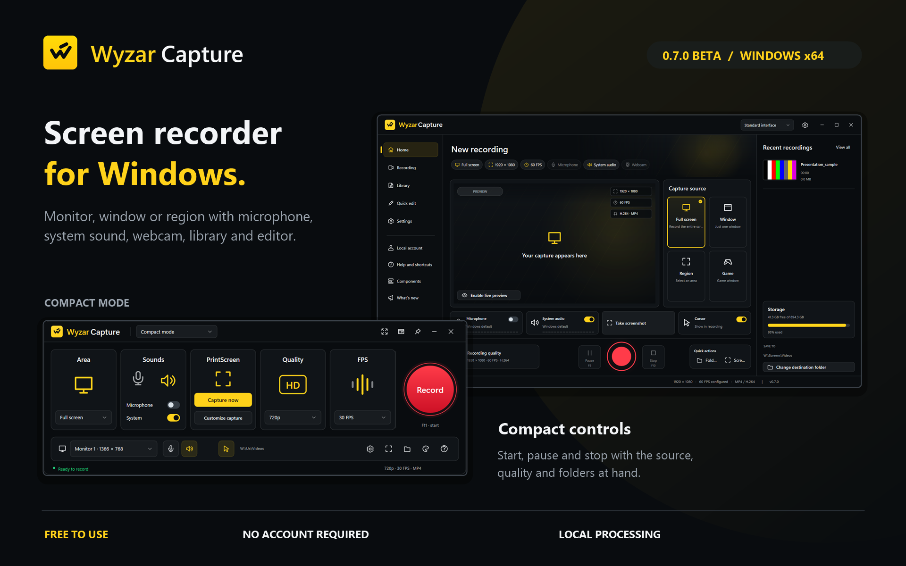
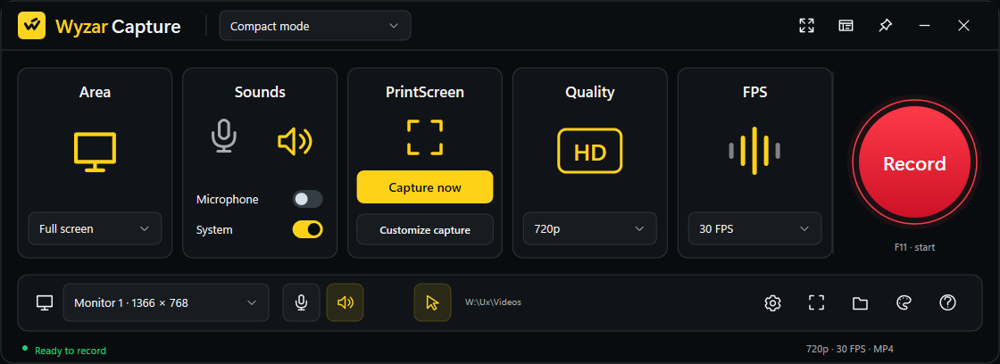
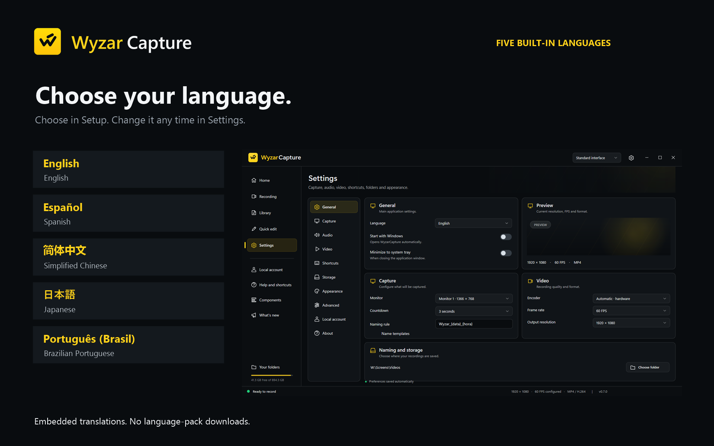
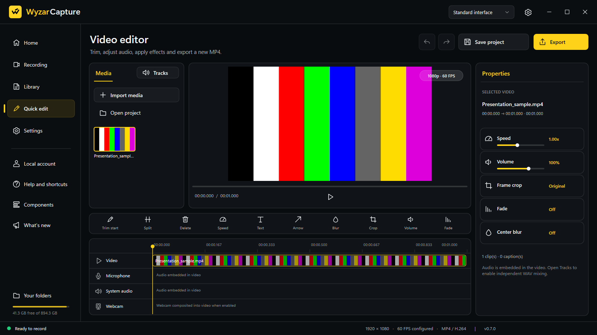
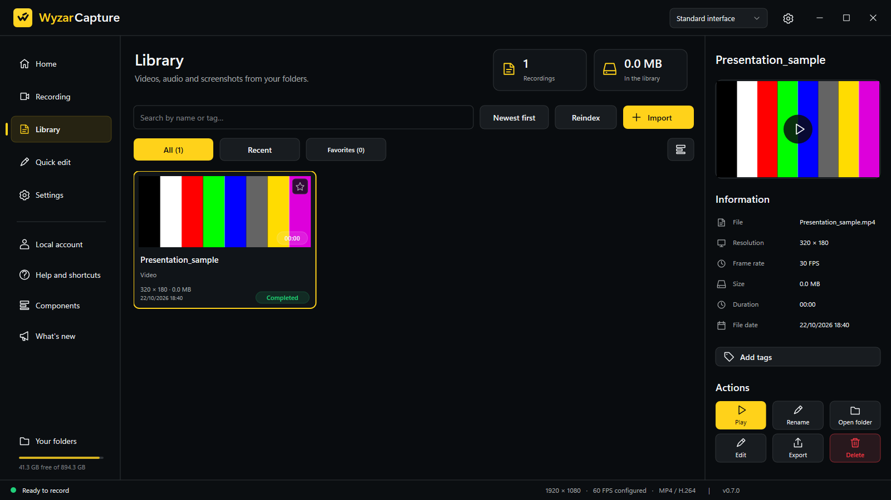
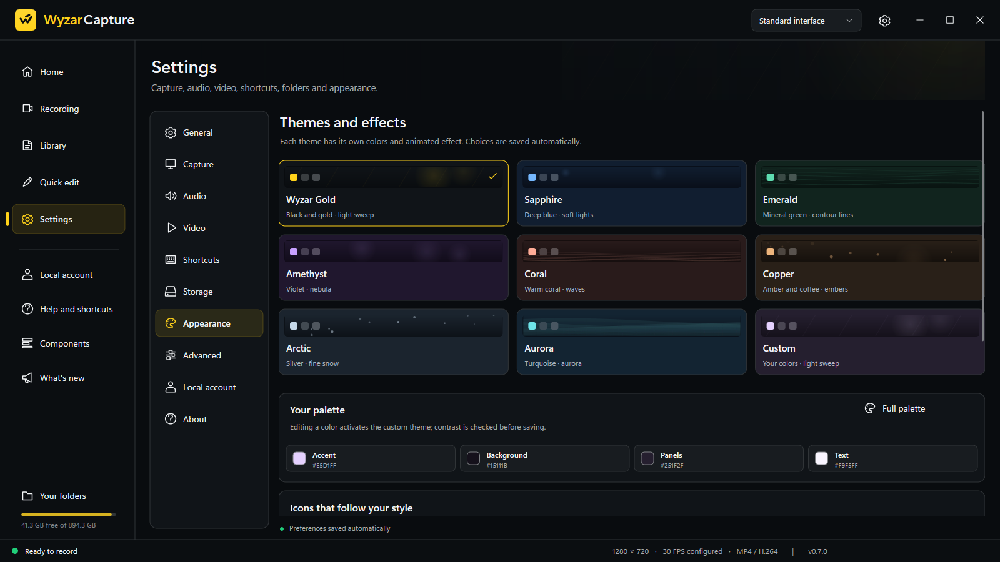
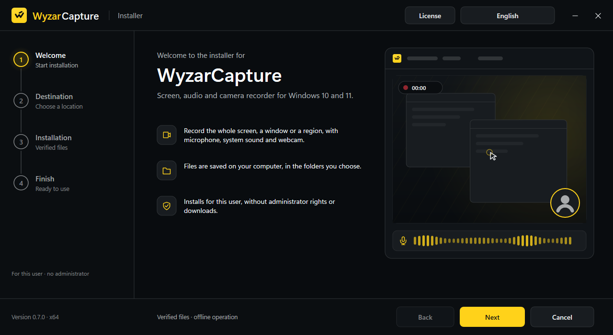

<strong>Record your screen, sound and camera. Keep your files on your computer.</strong>

Windows 10/11 x64 · 0.7.0 Beta · Native desktop application · Free to use

<a href="docs/INSTALLATION.md">Installation</a> · <a href="docs/QUICK_START.md">Quick start</a> · <a href="docs/LANGUAGES.md">Languages</a> · <a href="docs/GALLERY.md">Gallery</a> · <a href="docs/FAQ.md">FAQ</a>

**Release status:** 0.7.0 Beta is prepared and locally validated; its installer has not been uploaded to GitHub. The currently attached installer is [0.6.3 Beta](https://github.com/wesarbr/WyzarCapture/releases/tag/WyzarCapture). The screenshots and new features below describe 0.7.0. [Availability and tested scope](docs/BETA_STATUS.md).

## What it does

WyzarCapture is a native Windows screen, audio and webcam recorder with screenshots, a local media library, basic video editing and MP4 export. Choose what to capture, record it, find the result and prepare a version to share in one application.

Your files stay in folders you choose. Recording, previews, editing and export run locally. No online account is required, and this version implements no telemetry or automatic media uploads.

| Step | What you can do |
| --- | --- |
| **Capture** | Select a monitor, window or region; choose resolution and frame rate; pause, resume and save PNG screenshots. |
| **Record sound** | Combine microphone and system sound, record audio alone as WAV, or record the screen with separate WAV companion files. Enhance voice reduces rumble and background hiss. |
| **Camera** | Overlay a webcam in any corner as a rectangle, rounded tile or circle, optionally mirrored. |
| **Organize** | Browse thumbnails, search names and tags, use favorites, switch grid/list views and inspect file information. |
| **Edit** | Trim, split and remove clips; adjust speed and volume; add basic text, arrows, central blur, crop and fade effects. |
| **Export** | Create a new H.264/AAC MP4 with a chosen name, destination, resolution, frame rate and bitrate. |
| **Personalize** | Eight themes with their own animated effects or a custom palette, shortcuts, local recording profiles and five languages. |

## New in 0.7.0

- **Installer that understands your existing setup.** If WyzarCapture is already installed in another folder, Setup shows where and offers **Use current folder** or moves the program to the new folder. Videos, projects and preferences are not moved. Entries left by a deleted folder no longer block installation, and error messages no longer cover the options.
- **Cleaner interface.** Segoe UI Variable on Windows 11, functional text instead of slogans, a sliding navigation indicator, short transitions and a subtle animated effect for each theme. Motion follows the Windows animation setting and pauses while recording.
- **Lighter on modest PCs.** The window redraws only when something changes and recovers automatically after a graphics driver change.
- **Sharper recordings.** Variable bitrate with 2-second keyframes, a recommended bitrate for each resolution and frame rate, and antialiased scaling.
- **Better webcam and voice.** The camera uses its best native mode up to 720p and no longer slows the screen capture; Enhance voice cleans up the microphone.
- **Works where Windows Graphics Capture does not.** A compatible Windows capture path is used automatically.

[0.7.0 notes](docs/releases/0.7.0.md) · [Changelog](CHANGELOG.md)

**Availability:** the [existing Release](https://github.com/wesarbr/WyzarCapture/releases/tag/WyzarCapture) contains the 0.6.3 Beta installer. The 0.7.0 installer and its installation-flow changes are awaiting upload. Match the version you download to its entry on the [checksum page](docs/CHECKSUMS.md).

### A window that fits the task

The standard layout brings together preview, sources and devices. Focus, Compact and Compact focus layouts adapt the controls to your workspace. Compact mode provides start, pause and stop, a source preview, screenshot controls, quick access to your folders and an always-on-top option.

### Five languages, built in

Choose **English, Spanish, Simplified Chinese, Japanese or Brazilian Portuguese** in the installer's header or in **Settings › General › Language**. Translations are embedded; no language packs are downloaded. [Language guide](docs/LANGUAGES.md).

### Find the recording and continue in the editor

The Library brings together thumbnails, metadata, favorites and search. Projects use `.wyzproj` files that reference original media. Editing and exporting create another video; keep the original media available to reopen your project.

<strong>Explore the Library, themes and installer</strong>

**Library — browse and manage your local files.**

**Appearance — eight themes, each with its own animated effect, and a custom palette.**

**Installer — language, application destination and media folder choices.**

Images show the application's native renderer with isolated demonstration data and synthetic color bars. They are product illustrations, not performance benchmarks or evidence of physical camera testing. [Gallery context](docs/GALLERY.md).

## Install and make your first recording

Use the official [Releases page](https://github.com/wesarbr/WyzarCapture/releases) for installer downloads. The attached version is currently 0.6.3 Beta; the steps below describe the prepared 0.7.0 update. The Windows x64 installer is **WyzarCaptureSetup.exe**; only this executable is needed.

1. Run the Setup and select your language in its header.
2. Choose the application folder and your shortcuts. Keep the Windows media folders or choose a custom media folder. Installation is for the current Windows user, without administrator rights.
3. Open WyzarCapture, check the detected monitor and audio devices, and choose a source.
4. Make a short test, stop, then reopen it from the Library to check picture and sound.

**Default shortcuts:** F8 starts, F9 pauses/resumes, F10 stops and PrintScreen opens screenshot controls. F1 opens contextual help. [Full quick start](docs/QUICK_START.md).

## Requirements and beta boundaries

| Item | Requirement or current evidence |
| --- | --- |
| System | Windows 10 (version 2004 or later recommended) or Windows 11, x64. Windows Graphics Capture is used when available; otherwise a compatible Windows capture path is used. |
| Tested environment | Local Windows 11 Pro Insider Preview. The reported Windows 10 notebook remains a required retest. |
| Graphics | Direct3D 11 or the Windows software renderer in an interactive desktop session. |
| Media | Windows multimedia components. Windows N editions may need the Media Feature Pack. |
| Storage | Writable local or redirected destinations with room for recordings, temporary segments and exports. |
| Devices | Microphone/camera permissions and drivers for the optional functions you enable. |
| Other systems | macOS and Linux versions are not available. |

Automatic detection and conservative defaults help prepare recording; they do not guarantee a sustained frame rate. Actual performance depends on the source, drivers, encoder and storage. Exclusive game hooks, protected-content capture and universal anti-cheat compatibility are not implemented or certified. Recovery may lose the last open segment. [Detailed status](docs/BETA_STATUS.md) · [Troubleshooting](docs/TROUBLESHOOTING.md).

## Privacy, license and source

Your media stays under your control. Read the [privacy information](PRIVACY.md) for local data, retention and safe diagnostic sharing.

WyzarCapture is **freeware with proprietary code**. Personal, educational and professional use, including creating commercial content, is permitted under the [Freeware License](LICENSE.md). The [`source`](source/README.md) folder contains the application source code for reference under the same license; modification, redistribution and reverse engineering remain restricted subject to mandatory legal exceptions. Internal tests, release tooling, signing material and development notes are not published.

Use [Issues](https://github.com/wesarbr/WyzarCapture/issues) for reproducible bugs and suggestions. Include your Windows build, application version, selected language, steps and whether the problem persists with a writable local folder. Remove personal paths, names and private media. Follow the [security policy](SECURITY.md) for confidential reports. [Page maintenance](docs/MAINTENANCE.md).
