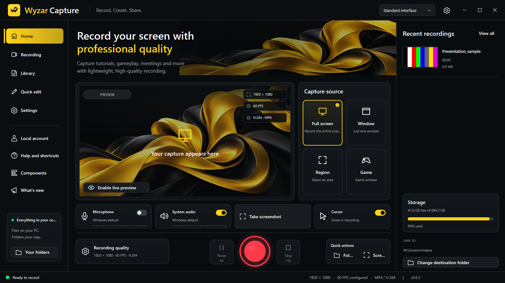
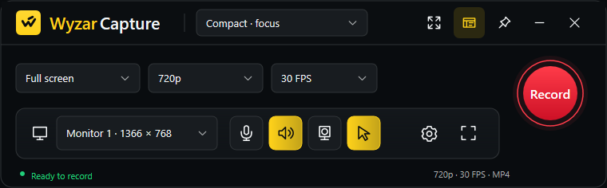
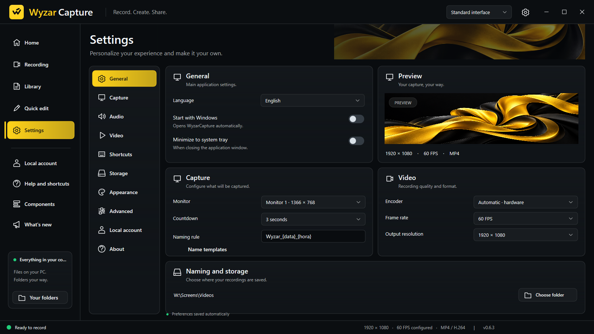

# Product gallery

These images use WyzarCapture's native renderer with isolated demonstration preferences. Color bars are synthetic media; no private desktop, microphone recording or personal project is used in the public gallery. The presentation cover combines official brand assets with native UI images. Displayed quality settings and available storage are examples, not benchmarks.

Screens and artwork with a version label have been refreshed for the prepared **0.6.3 Beta** update. The version-neutral logo and compact illustrations are retained; those earlier compact layouts do not show every new control. Monitor names, dimensions, paths, shortcuts and storage figures are examples from the isolated rendering environment.

## Standard workspace

## Language choices

## Compact and Compact focus

## Library and editor

## Preferences and appearance

## Installer

Native renderer output documents layout. It does not replace physical input testing, other display scaling, a Windows 10 notebook retest or testing a physical camera. [Beta status](BETA_STATUS.md) · [Back to project](../README.md).
